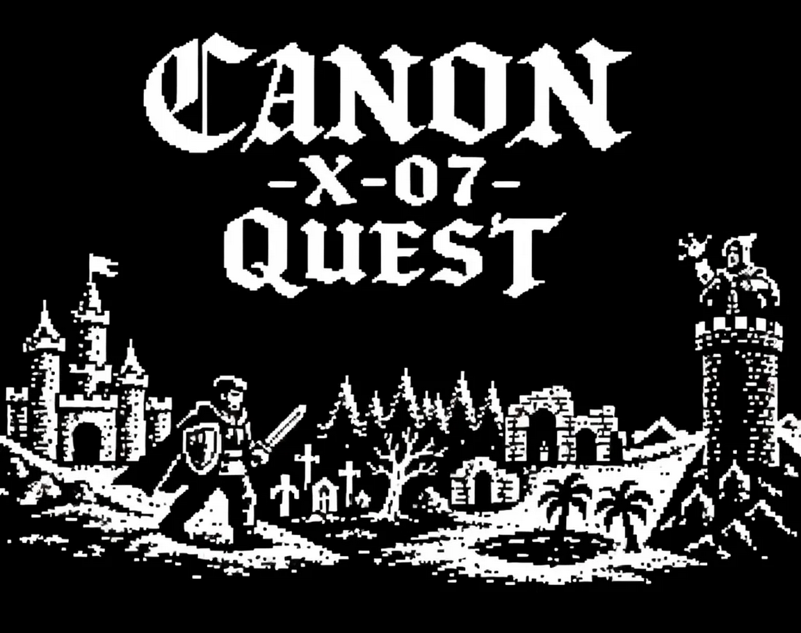
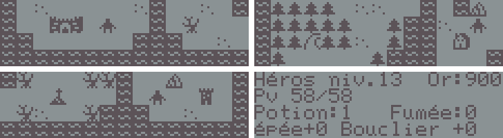

# Canon X-07 Quest





[Français](#fr) · [English](#en)

<a id="fr"></a>

## 🇫🇷 Français

### Présentation
`Canon X-07 Quest` est un mini-RPG en assembleur Z80 pour l’ordinateur de poche Canon X-07.

Le joueur incarne un héros envoyé par le roi pour retrouver un sorcier en fuite. L’aventure commence près du château, puis traverse le cimetière, la forêt, les ruines, l’oasis et enfin la tour noire.

Le jeu propose une musique monophonique, une carte de 30x16 cases à explorer, 7 types d’ennemis différents, 7 lieux à visiter et environ une bonne heure de jeu.

Le jeu a été réalisé dans le cadre de la Game Jam Retro Programmers United for Obscure Systems, session Canon X-07 de 2026 :
[https://itch.io/jam/rpufos-canon-x07](https://itch.io/jam/rpufos-canon-x07)

Le projet a été développé avec l’aide de ChatGPT 5.4.

### Matériel requis
Une puce d’extension RAM de 8 ko est obligatoire.

Modèles testés :
- `Toshiba TC5565PL-15`
- `Toshiba TC5565APL-10L`
- ou tout équivalent compatible

### Chargement
1. Télécharger la [version française](bin/quest_FR.bin) ou la [version anglaise](bin/quest_EN.bin).
2. Avec le [Canon X-07 Serial Fast Loader](https://github.com/pR-0000/Canon-X-07-Serial-Fast-Loader), placer le chargeur à `$1F00`, puis envoyer le binaire du jeu à **`$2000`**. Le chargeur lance le jeu. Il n’est pas nécessaire d’exécuter `FSET 13`.
3. Si le binaire est déjà en mémoire (chargement par une autre méthode ou retour au BASIC), le lancer avec :

```basic
EXEC&H2000
```

### Compilation
Depuis la racine du dépôt, [`compile.bat`](compile.bat) construit les deux versions sous Windows avec **SjASMPlus** (testé avec la version 1.21.0). Placer l’assembleur dans le `PATH` ou son exécutable dans le dossier parent du dépôt.

Pour assembler à la main, sans modifier [`src/quest.z80`](src/quest.z80) :

```bash
sjasmplus -Isrc -DBUILD_LANG_EN=0 --raw=bin/quest_FR.bin src/quest.z80
sjasmplus -Isrc -DBUILD_LANG_EN=1 --raw=bin/quest_EN.bin src/quest.z80
```

Pour lancer les tests de la carte et des commandes : `python tests/test_world.py` (nécessite SjASMPlus et le paquet Python `z80`).

### Organisation du dépôt
- [`bin/`](bin/) : les deux versions prêtes à charger sur le X-07.
- [`src/`](src/) : le jeu en assembleur Z80 et les données utilisées à la compilation.
- [`assets/maps/`](assets/maps/) : la carte éditable avec Tiled, son jeu de tuiles et son image.
- [`docs/images/`](docs/images/) : l’illustration du titre et les captures d’écran.
- [`tools/`](tools/) et [`tests/`](tests/) : le convertisseur d’images BMP et les tests de régression.

### Commandes
- Flèches directionnelles : déplacer le héros et déplacer le curseur dans les menus
- `F6` (au centre des flèches) : valider
- `DEL` : annuler, et ouvrir le menu de statistiques du héros sur la carte
- Clavier `QWERTY` : saisir les mots pendant les combats
- `BREAK` : quitter le jeu et revenir au BASIC lorsque le joueur se trouve sur la carte

### Histoire
Le roi charge le héros de poursuivre un sorcier qui a fui le royaume. Pour le retrouver, il faudra explorer plusieurs régions, vaincre les gardiens qui protègent sa fuite et progresser jusqu’à la tour noire où se déroule l’affrontement final.

### Système de combat
Les combats sont aléatoires sur la carte, à l’exception des boss.

Lors d’une attaque, un défi de frappe apparaît. Le joueur doit retaper rapidement le mot affiché pour obtenir un bonus de dégâts :
- réussite normale : petit bonus
- réussite rapide : bonus plus fort
- échec : aucun bonus

Le joueur peut se soigner dans les auberges, acheter des potions pour récupérer des PV pendant les combats, ou utiliser de la fumée pour s’enfuir à coup sûr.

Le jeu mélange donc progression RPG, équipement et rapidité de frappe.

### Remarque sur l’affichage
Sur certains X-07, quelques pixels peuvent apparaître en retard lors des écritures rapides vers le contrôleur d’affichage T6834. Cet effet est visuel : il n’affecte ni les commandes ni la sauvegarde.

### Correctif de la carte
Sur certains X-07, la carte s’affichait et la musique continuait, mais les flèches et `DEL` ne répondaient plus. Le jeu dessine désormais les 32 lignes de l’écran, affiche le héros, puis reprend la lecture du clavier sans attendre un indicateur de redessin en RAM. Le correctif s’applique aussi aux changements de zone. Les sauvegardes existantes restent compatibles ; aucun `POKE` n’est nécessaire.

### Sauvegarde
La progression est sauvegardée automatiquement pendant l’aventure.

Pour reprendre la partie, relancez le jeu et choisissez de continuer à l’écran titre.

---

<a id="en"></a>

## 🇬🇧 English

### Overview
`Canon X-07 Quest` is a small Z80 assembly RPG for the Canon X-07 pocket computer.

You play a hero sent by the king to track down a fleeing sorcerer. The adventure begins near the castle, then continues through the graveyard, the forest, the ruins, the oasis, and finally the black tower.

The game features monophonic music, a 30x16-tile world map to explore, 7 enemy types, 7 places to visit, and roughly one good hour of playtime.

The game was created for the Retro Programmers United for Obscure Systems Game Jam, Canon X-07 2026 session:
[https://itch.io/jam/rpufos-canon-x07](https://itch.io/jam/rpufos-canon-x07)

The project was developed with the help of ChatGPT 5.4.

### Hardware Requirements
An 8 KB RAM expansion chip is mandatory.

Tested models:
- `Toshiba TC5565PL-15`
- `Toshiba TC5565APL-10L`
- or any compatible equivalent

### Loading
1. Download the [French build](bin/quest_FR.bin) or the [English build](bin/quest_EN.bin).
2. With the [Canon X-07 Serial Fast Loader](https://github.com/pR-0000/Canon-X-07-Serial-Fast-Loader), place the loader at `$1F00`, then send the game binary to **`$2000`**. The loader starts the game. You do not need to run `FSET 13`.
3. If the binary is already in memory (after loading it another way or returning to BASIC), start it with:

```basic
EXEC&H2000
```

### Build
From the repository root, [`compile.bat`](compile.bat) builds both versions on Windows with **SjASMPlus** (tested with version 1.21.0). Put the assembler on your `PATH` or place its executable in the parent directory of the repository.

To assemble manually without editing [`src/quest.z80`](src/quest.z80):

```bash
sjasmplus -Isrc -DBUILD_LANG_EN=0 --raw=bin/quest_FR.bin src/quest.z80
sjasmplus -Isrc -DBUILD_LANG_EN=1 --raw=bin/quest_EN.bin src/quest.z80
```

To test map rendering and controls, run `python tests/test_world.py` (requires SjASMPlus and the Python `z80` package).

### Repository Layout
- [`bin/`](bin/): the two builds ready to load on the X-07.
- [`src/`](src/): Z80 game source and the data used at assembly time.
- [`assets/maps/`](assets/maps/): the editable Tiled map, its tileset, and its image.
- [`docs/images/`](docs/images/): title artwork and screenshots.
- [`tools/`](tools/) and [`tests/`](tests/): the BMP converter and regression tests.

### Controls
- Direction keys: move the hero and move the cursor in menus
- `F6` (in the centre of the arrow keys): confirm
- `DEL`: cancel, and open the hero status menu on the world map
- `QWERTY` keyboard: type words during battles
- `BREAK`: quit the game and return to BASIC while the player is on the world map

### Story
The king sends the hero after a sorcerer who has fled the kingdom. To catch him, the player must explore several regions, defeat the guardians along his path, and eventually reach the black tower for the final battle.

### Battle System
Battles are random on the world map, except for bosses.

During an attack, a typing challenge appears. The player must quickly type the displayed word to gain a damage bonus:
- normal success: small bonus
- fast success: stronger bonus
- failure: no bonus

The hero can recover at inns, buy potions to heal during battles, or use smoke to flee with a guaranteed escape.

The game is built around a mix of RPG progression, equipment upgrades, and typing speed.

### Display Note
On some X-07 units, a few pixels may appear late during rapid writes to the T6834 display controller. This is cosmetic: it does not affect controls or saves.

### Map Bug Fix
On some X-07 units, the map appeared and the music kept playing, but the arrow keys and `DEL` stopped responding. The game now draws all 32 screen lines, displays the hero, then reads the keyboard again without waiting on a redraw flag in RAM. The fix also applies when crossing into another area. Existing saves remain compatible; no `POKE` is needed.

### Save System
Progress is saved automatically during the adventure.

To resume, restart the game and choose to continue on the title screen.
